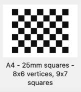

# Calibration Setup

## Applications Needed
- OBS on your laptop: https://obsproject.com/download
- DroidCam on your iPhone
- DroidCam extension for OBS Studio: https://droidcam.app/
- Print checkerboard: https://markhedleyjones.com/projects/calibration-checkerboard-collection

**Default checkerboard:** 9 columns, 7 rows, and 25 mm squares, as shown below.



## Steps

### 1. Open OBS
Open OBS, add a new Source, and select **DroidCam**. You can name the new source anything.

### 2. Set the Resolution
Double-click the new Source and make sure the resolution is **1920 × 1080**.

### 3. Connect Your iPhone
Open DroidCam on your iPhone. Enter the network IP shown on the iPhone into the **WiFi IP** section in OBS.

### 4. Start Virtual Camera
Once connected, click **Start Virtual Camera** in OBS.

### 5. Edit the Calibration Script
Edit the `calibrate_iphone.sh` code in the usb_cam folder.
- Add your phone profile, similar to how it is done for `iphone14`. You can use one of the other profiles if it fits your phone and lens.
- If you use a different checkerboard for calibration, update the code based on the board used.

### 6. Run the Calibration Script
Under the Calibration folder, run:

```bash
./usb_cam/calibrate_iphone.sh iphone14
```

----

# Editing Pool Layout steps

Edit `Pool_layout.py`. Things to change are:

1. Change the type and ID of the AprilTags being used.
2. Change the size of the AprilTags.
3. Update the distance and placement of the AprilTags.
  - Set one AprilTag as the origin `(0, 0)`.
  - Place another AprilTag along the X-axis.
  - Place another AprilTag along the Y-axis.
  - Place the last AprilTag diagonally from the origin.

### Running the Tracking Script

Step 1: Navigate to the `usb_cam` directory.

```bash
cd usb_cam
```
```bash
python3 track_rov_topview.py --dynamic-homography
```
